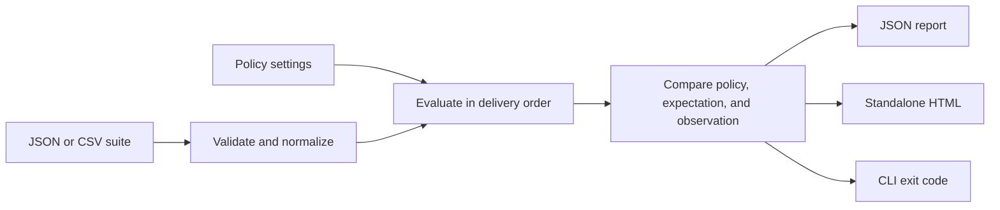

# Architecture

Preflight answers one question about each synthetic delivery. Does the exported decision match both the business policy and the independently authored expectation?

| Module | Responsibility |
| --- | --- |
| `inputs.py`, `model.py` | Validate field types, intent-specific payloads, IDs and references. Normalize both input formats into the same model. |
| `config.py`, `policy.py` | Validate declarative settings and derive the policy decision with a reason and record references. |
| `runner.py` | Compare the policy, expectation, and observations, then aggregate findings and coverage. |
| `report.py`, `cli.py` | Render escaped local reports and expose exit codes for automation. |

## Policy evaluation

The manifest fixes the clock. Each case starts with an independent snapshot. The runner sorts events by `sequence`.

1. **Delivery identity.** Claim a source delivery key on its first appearance. Replays call for a skip. A separate task key catches a repeated business action from distinct source deliveries.
2. **Event order.** For events with a stream key, maintain the latest usable occurrence time. An older occurrence calls for a skip. Unknown timestamps keep later events in that stream inconclusive unless a known watermark proves they are stale.
3. **Record identity.** Resolve an account by its stable ID or a unique exact domain. If an event includes both, they must agree. Hold shared-domain decisions for review. Parent and subsidiary records can share a domain and retain separate identities and ownership.
4. **Known suppression.** On outreach, a resolved customer's flag or an explicit opt-out on the supplied contact can establish a skip even if other inputs are missing. The remaining outreach checks establish contact identity, the customer and suppression flags, enrichment freshness, and recorded research. A confirmed duplicate contact, mismatched contact account, stale enrichment, or completed research without evidence calls for review.
5. **Intent policy.** Route using the configured owner authority. Test stage moves against the lifecycle graph and the account snapshot. For a task, consult earlier observed allow rows with the same account and business task key. If an earlier incomplete observation could represent the same task, a later proposed task remains inconclusive.

The engine keeps this state in memory. Findings use the clock, configuration, and snapshot from the fixture. Running the same inputs produces byte-identical reports.

## Outcomes and reports

- **Pass** means one complete observed decision agrees with the fixture expectation and the determinable policy decision. A proven suppression or a required review can pass when the workflow explicitly exports the corresponding decision.
- **Fail** means the observed decisions violate an established rule or expectation, the workflow exported multiple decisions for one event, or the fixture expectation contradicts an established policy decision. A case or suite with any failure has a fail status.
- **Inconclusive** means no failure is established and required evidence, an expectation, or an observation is incomplete. Exit code `3` surfaces this in automation by default.

The JSON report uses `schema_version: 1`. Its top-level `summary` counts findings. Each case contains its own status and summary. Findings contain `rule_id`, `policy_rule_id`, severity, business rule, expected and policy decisions, actual rows, affected record IDs, detail, and a suggested correction. The `coverage` section counts cases, events, and the number of events that reached each recorded policy rule. An event can reach multiple rules. Coverage measures exercised fixture paths.

Each report file is replaced atomically. Use distinct `--output` directories for concurrent runs and use the CLI exit code to confirm that both files were written. Opening HTML works offline and uses local page anchors, semantic headings, and status text.

## MVP limits

- The unit of analysis is a single exported decision intent per event. Preflight uses snapshots and case-local delivery and task history. Account, consent, owner, and lifecycle fields are static within each case.
- Field authority is explicit for the two owner sources. Identity uses exact IDs and domains, and duplicates use normalized mailboxes. Fuzzy matching, canonical merge logic, territory assignment, and parent-level ownership or suppression inheritance are outside this model.
- The event stream uses fixture sequence and timestamps. Real delivery races, storage transactions, storage-backed idempotency, vendor execution logic, and CRM integration behavior require tests at those layers.
- Evidence validation covers the URL and fixture metadata. Source content, data provenance, and real-world compliance require independent review.
- Inputs are loaded into memory. Use small synthetic suites and separate snapshots for different workflow states.
